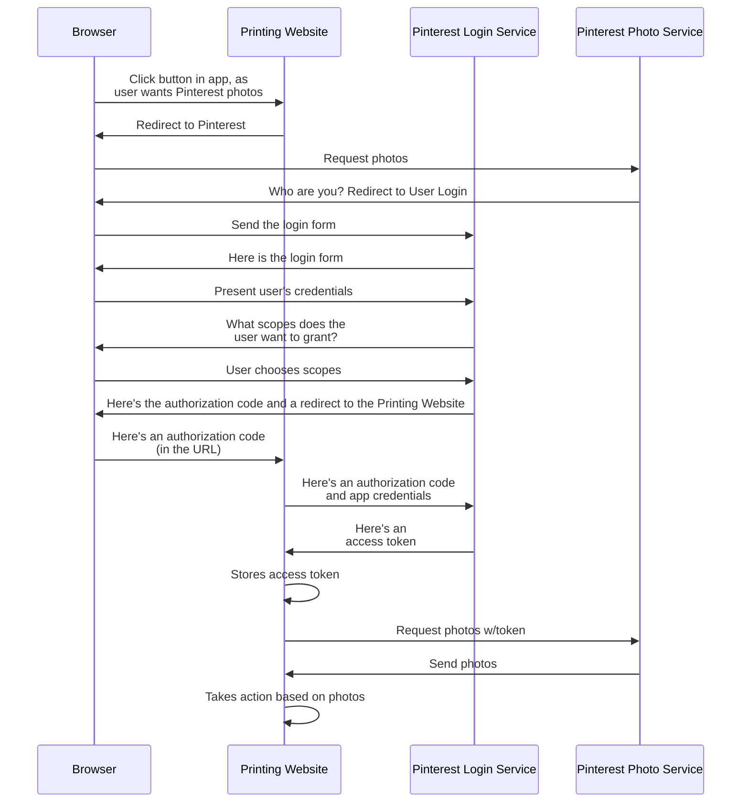

import ClientCredentials from "public/img/articles/modern-guide-oauth/client-credentials-grant-svg.astro";

I know what you are thinking, is this really another guide to OAuth 2.0?

Well, yes and no. This guide is different from most of the others out there because it covers all of the ways that we actually use OAuth. It also covers all of the details you need to be an OAuth expert without reading all the specifications or writing your own OAuth server. This document is based on hundreds of conversations and client implementations as well as our experience building FusionAuth, an OAuth server which has been downloaded over a million times.

If that sounds good to you, keep reading!

## What Is OAuth 2.0?

OAuth 2.0 is a set of specifications that allow developers to easily delegate the authentication and authorization of their users to someone else. While the specifications don't specifically cover authentication, in practice this is a core piece of OAuth, so we will cover it in depth (because that's how we roll).

OAuth in general was designed as a reaction to the direct authentication pattern, which features applications requesting usernames and passwords when accessing user-specific data at other services. When utilizing OAuth, the user still provides this information, but they log into one platform and use tokens generated by that platform to grant access to data and perform actions in one or more other applications. These applications may be owned by third parties or by the same folks who control the authentication platform. This flexibility is one reason for confusion when it comes to OAuth.

Before authentication and authorization with OAuth was available, websites would ask users to enter a username and password into a form, for example the credentials for a Gmail account, to gain access to Gmail data. Users realized they didn't want to grant full access to any old service. They preferred limited access instead. A user might want a third party service to access their email account, but only have rights to read contacts, not send email or add contacts.

When using OAuth, a token, which has a limited lifetime, provides that constrained access. Connecting multiple applications is easier for users. It is also more secure since [user credentials](/articles/ciam/challenges-of-ciam) are not shared. Auth is also easier for developers to manage because they only need to integrate OAuth 2.0 in their application instead of having their own database to store users' sensitive information.

OAuth and SAML are sometimes confused. SAML is primarily an authentication system used for single sign-on, while OAuth is an authorization system that has authentication layered on top of it (OpenID Connect, or OIDC). Authentication is about confirming the user's identity. Authorization is about deciding what services, functionality or data they can access. A detailed comparison between [OAuth and SAML is found here](/articles/oauth/saml-vs-oauth) .

What does the phrase used above, "delegate the authentication and authorization of their users to someone else", mean, really?

It means that your application sends the user over to an OAuth server, the user logs in, and then the user is sent back to your application. But. There are a couple of different twists and goals of this process. Let's cover those next.

## How Does OAuth 2.0 Work?

None of the specifications cover how OAuth is actually integrated into applications. Whoops! But as a developer, that's what you care about. They also don't cover the different workflows or processes that leverage OAuth. They leave almost everything up to the implementer (the person who writes the OAuth Server) and integrator (the person who integrates their application with that OAuth server).

Rather than just reword the information in the specifications (yet again), let's create a vocabulary for real-world integrations and implementations of OAuth. We'll call them **OAuth modes**.

There are eight OAuth modes in common use today. These real world OAuth modes are:

1. Local login and registration
1. Third-party login and registration _(federated identity)_
1. First-party login and registration _(reverse federated identity)_
1. Enterprise login and registration _(federated identity with a twist)_
1. Third-party service authorization
1. First-party service authorization
1. Machine-to-machine authentication and authorization
1. Device login and registration

I've included notation on a few of the items above specifying which are federated identity workflows. The reason that I've changed the names here from just "federated identity" is that each case is slightly different. Plus, the term federated identity is often overloaded and misunderstood. To help clarify terms, I'm using "login" instead. However, this is generally the same as "federated identity" in that the user's identity is stored in an OAuth server and the authentication/authorization is delegated to that server.

Let's discuss each mode in a bit more detail, but first, a cheat sheet.

### Which OAuth Mode Is Right for You?

Wow, that's a lot of different ways you can use OAuth. That's the power and the danger of OAuth, to be honest with you. It is so flexible that people new to it can be overwhelmed. So, here's a handy set of questions for you to ask yourself.

* Are you looking to outsource your authentication and authorization to a safe, secure and standards-friendly auth system? You'll want [Local login and registration](#local-login-and-registration) in that case.
* Trying to avoid storing any credentials because you don't want responsibility for passwords? [Third-party login and registration](#third-party-login-and-registration) is where it's at.
* Are you selling to Enterprise customers? Folks who hear terms like SAML and SOC2 and are comforted, rather than disturbed? Scoot on over to [Enterprise login and registration](#enterprise-login-and-registration).
* Are you building service to service communication with no user involved? If so, you are looking for [Machine-to-machine authorization](#machine-to-machine-authorization).
* Are you trying to let a user log in from a separate device? That is, from a TV or similar device without a friendly typing interface? If this is so, check out [Device login and registration](#device-login-and-registration).
* Are you building a platform and want to allow other developers to ask for permissions to make calls to APIs or services on your platform? Put on your hoodie and review [First-party login and registration](#first-party-login-and-registration) and [First-party service authorization](#first-party-service-authorization).
* Do you have a user store already integrated and only need to access a third party service on your users' behalf? Read up on [Third-party service authorization](#third-party-service-authorization).

With that overview done, let's examine each of these modes in more detail.

### Local Login and Registration

The **Local login and registration** mode is when you use an OAuth workflow to register or log users into your application. In this mode, you own both the OAuth server and the application. You might not have written the OAuth server (if you use a product such as FusionAuth), but you control it. In fact, this mode usually feels like the user is signing up or logging directly into your application via **native forms** and there is no delegation at all.

What do we mean by native forms? Most developers have at one time written their own login and registration forms directly into an application. They create a table called `users` and it stores `username`s and `password`s. Then they write the registration and the login forms (HTML or some other UI). The registration form collects the `username` and `password` and checks if the user exists in the database. If they don't, the application inserts the new user into the database. The login form collects the `username` and `password` and checks if the account exists in the database and logs the user in if it does. This type of implementation is what we call native forms.

The only difference between native forms and the **Local login and registration** OAuth mode is that with the latter you delegate the login and registration process to an OAuth server rather than writing everything by hand. Additionally, since you control the OAuth server and your application, it would be odd to ask the user to "authorize" your application. Therefore, this mode does not include the permission grant screens that often are mentioned in OAuth tutorials. Never fear; we'll cover these in the next few sections.

So, how does this work in practice? Let's take a look at the steps for a fictitious web application called "The World's Greatest ToDo List" or "TWGTL" (pronounced Twig-Til):

1. A user visits TWGTL and wants to sign up and manage their ToDos.
1. They click the <Breadcrumb>Sign Up</Breadcrumb> button on the homepage.
1. This button takes them over to the OAuth server. In fact, it takes them directly to the registration form that is included as part of the OAuth workflow (specifically the Authorization Code grant which is covered later in this guide).
1. They fill out the registration form and click <Breadcrumb>Submit</Breadcrumb>.
1. The OAuth server ensures this is a new user and creates their account.
1. The OAuth server redirects the browser back to TWGTL, which logs the user in.
1. The user uses TWGTL and adds their current ToDos. Yay!
1. The user stops using TWGTL; they head off and do some ToDos.
1. Later, the user comes back to TWGTL and needs to sign in to check off some ToDos. They click the <Breadcrumb>My Account</Breadcrumb> link at the top of the page.
1. This takes the user to the OAuth server's login page.
1. The user types in their username and password.
1. The OAuth server confirms their identity.
1. The OAuth server redirects the browser back to TWGTL, which logs the user in.
1. The user interacts with the TWGTL application, merrily checking off ToDos.

That's it. The user feels like they are registering and logging into TWGTL directly, but in fact, TWGTL is delegating this functionality to the OAuth server. The user is none-the-wiser so this is why we call this mode *Local login and registration*.

#### An Aside About This Mode and Mobile Applications

The details of this mode has implications for the security best practices recommended by some of the standards bodies. In particular, the [OAuth 2.0 for Native Apps](https://tools.ietf.org/html/rfc8252) Best Current Practices (BCP) recommends against using a webview:

> This best current practice requires that native apps MUST NOT use embedded user-agents to perform authorization requests...

This is because the "embedded user-agents", also known as webviews, are under control of the mobile application developer in a way that the system browser is not.

If you are operating in a mode where the OAuth server is under a different party's control, such as the third-party login that we'll cover next, this prohibition makes sense. But in this mode, you control everything. In that case, the chances of a malicious webview being able to do extra damage is minimal, and must be weighed against the user interface issues associated with popping out to a system browser for authentication. Additionally, with modern mobile operating systems, the system browser can be configured to look quite similar to the mobile application.

### Third-party Login and Registration

The **Third-party login and registration** mode is typically implemented with the classic <Breadcrumb>Login with ...</Breadcrumb> buttons you see in many applications. These buttons let users sign up or log in to your application by logging into one of their other accounts (i.e. Facebook or Google). Here, your application sends the user over to Facebook or Google to log in.

Let's use Facebook as an example OAuth provider. In most cases, your application will need to use one or more APIs from the OAuth provider in order to retrieve information about the user or do things on behalf of the user (for example sending a message on behalf of the user). In order to use those APIs, the user has to grant your application permissions. To accomplish this, the third-party service usually shows the user a screen that asks for certain permissions. We'll refer to these screens as the "permission grant screen" throughout the rest of the guide.

For example, Facebook will present a screen asking the user to share their email address with your application. Once the user grants these permissions, your application can call the Facebook APIs using an access token (which we will cover [later in this guide](#third-party-login-and-registration-also-enterprise-login-and-registration-with-the-authorization-code-grant)).

Here's an example of the Facebook permission grant screen, where Zapier would like to access a user's email address:

After the user has logged into the third-party OAuth server and granted your application permissions, they are redirected back to your application and logged into it.

This mode is different from the previous mode because the user logs in but also grants your application permissions to the service (Facebook). This is one reason so many applications leverage "Login with Facebook" or other social integrations. It not only logs the user in, but also gives them access to call the Facebook APIs on the user's behalf.

Social logins are the most common examples of this mode, but there are plenty of other third-party OAuth servers beyond social networks (GitHub or Discord for example).

This mode is a good example of federated identity. Here, the user's identity (username and password) is stored in the third-party system. They use that system to register or log in to your application.

So, how does this work in practice? Let's take a look at the steps for our TWGTL application if we want to use Facebook to register and log users in:

1. A user visits TWGTL and wants to sign up and manage their ToDos.
1. They click the <Breadcrumb>Sign Up</Breadcrumb> button on the homepage.
1. On the login and registration screen, the user clicks the <Breadcrumb>Login with Facebook</Breadcrumb> button.
1. This button takes them over to Facebook's OAuth server.
1. They log in to Facebook (if they aren't already logged in).
1. Facebook presents the user with the permission grant screen based on the permissions TWGTL needs. This is done using OAuth scopes, covered above.
1. Facebook redirects the browser back to TWGTL, which logs the user in. TWGTL also calls Facebook APIs to retrieve the user's information.
1. The user begins using TWGTL and adds their current ToDos.
1. The user stops using TWGTL; they head off and do some ToDos.
1. Later, the user comes back to TWGTL and needs to log in to check off some of their ToDos. They click the <Breadcrumb>My Account</Breadcrumb> link at the top of the page.
1. This takes the user to the TWGTL login screen that contains the <Breadcrumb>Login with Facebook</Breadcrumb> button.
1. Clicking this takes the user back to Facebook and they repeat the same process as above.

You might wonder if the **Third-party login and registration** mode can work with the **Local login and registration** mode. Absolutely! This is what I like to call **Nested federated identity** (it's like a [hot pocket in a hot pocket](https://www.youtube.com/watch?v=N-i9GXbptog)). Basically, your application delegates its registration and login forms to an OAuth server like FusionAuth. Your application also allows users to sign in with Facebook by enabling that feature of the OAuth server (FusionAuth calls this the **Facebook Identity Provider**). It's a little more complex, but the flow looks something like this:

1. A user visits TWGTL and wants to sign up and manage their ToDos.
1. They click the <Breadcrumb>Sign Up</Breadcrumb> button on the homepage.
1. This button takes them over to the OAuth server's login page.
1. On this page, there is a button to "Login with Facebook" and the user clicks that.
1. This button takes them over to Facebook's OAuth server.
1. They log in to Facebook.
1. Facebook presents the user with the permission grant screen.
1. The user authorizes the requested permissions.
1. Facebook redirects the browser back to TWGTL's OAuth server, which reconciles out the user's account.
1. TWGTL's OAuth server redirects the user back to the TWGTL application.
1. The user is logged into TWGTL.

> What does "reconcile out" mean? OAuth has its jargon, oh yes. To reconcile a user with a remote system means optionally creating a local account and then attaching data and identity from a remote data source like Facebook to that account. The remote account is the authority and the local account is modified as needed to reflect remote data.

The nice part about this workflow is that TWGTL doesn't have to worry about integrating with Facebook (or any other provider) or reconciling the user's account. That's handled by the OAuth server. It's also possible to delegate to additional OAuth servers, easily adding "Login with Google" or "Login with Apple". You can also nest deeper than the 2 levels illustrated here.

### First-party Login and Registration

The **First-party login and registration** mode is the inverse of the **Third-party login and registration** mode. Basically, if you happen to be Facebook (hi Zuck!) in the examples above and your customer is TWGTL, you are providing the OAuth server to TWGTL. You are also providing a way for them to call your APIs on behalf of your users.

This type of setup is not just reserved for the massive social networks run by Silicon Valley moguls; more and more companies are offering this to their customers and partners, therefore becoming platforms.

In many cases, companies are also leveraging easily integratable auth systems like FusionAuth to provide this feature.

### Enterprise Login and Registration

The **Enterprise login and registration** mode is when your application allows users to sign up or log in with an enterprise identity provider such as a corporate Active Directory. This mode is very similar to the **Third-party login and registration** mode, but with a few salient differences.

First, it rarely requires the user to grant permissions to your application using a permission grant screen. Typically, a user does not have the option to grant or restrict permissions for your application. These permissions are usually managed by IT in an enterprise directory or in your application.

Second, this mode does not apply to all users of an application. In most cases, this mode is only available to the subset of users who exist in the enterprise directory. The rest of your users will either log in directly to your application using **Local login and registration** or through the **Third-party login and registration** mode. In some cases, the user's email address determines the authentication source.

You might have noticed some login forms only ask for your email on the first step like this:

Knowing a user's email domain allows the OAuth server to determine where to send the user to log in or if they should log in locally. If you work at Example Company, proud purveyors of TWGTL, providing `brian@example.com` to the login screen allows the OAuth server to know you are an employee and should be authenticated against a corporate authentication source. If instead you enter `dan@gmail.com`, you won't be authenticated against that directory.

Outside of these differences, this mode behaves much the same as the **Third-party login and registration** mode.

This is the final mode where users can register and log in to your application. The remaining modes are used entirely for authorization, usually to application programming interfaces (APIs). We'll cover these modes next.

### Third-party Service Authorization

The third-party service authorization mode is quite different from the **Third-party login and registration** mode; don't be deceived by the similar names. Here, the user is already logged into your application. The login could have been through a native form (as discussed above) or using the **Local login and registration** mode, the **Third-party login and registration** mode, or the **Enterprise login and registration** mode. Since the user is already logged in, all they are doing is granting access for your application to call third-party's APIs on their behalf.

For example, let's say a user has an account with TWGTL, but each time they complete a ToDo, they want to let their [WUPHF](https://www.youtube.com/watch?v=yL1z1ZHD0K4) followers know. (WUPHF is an up and coming social network; sign up at getwuphf.com.) To accomplish this, TWGTL provides an integration that will automatically send a WUPHF when the user completes a ToDo. The integration uses the WUPHF APIs and calling those requires an access token. In order to get an access token, the TWGTL application needs to log the user into WUPHF via OAuth.

To hook all of this up, TWGTL needs to add a button to the user's profile page that says "Connect your WUPHF account". Notice it doesn't say "Login with WUPHF" since the user is already logged in; the user's identity for TWGTL is not delegated to WUPHF. Once the user clicks this button, they are taken to WUPHF's OAuth server to log in and grant the necessary permissions for TWGTL to WUPHF for them.

Since WUPHF doesn't actually exist, here's an example screenshot from Buffer, a service which posts to your social media accounts such as Twitter.

When you connect a Twitter account to Buffer, you'll see a screen like this:

The workflow for this mode looks like this:

1. A user visits TWGTL and logs into their account.
1. They click the <Breadcrumb>My Profile</Breadcrumb> link.
1. On their account page, they click the <Breadcrumb>Connect your WUPHF account</Breadcrumb> button.
1. This button takes them over to WUPHF's OAuth server.
1. They log in to WUPHF.
1. WUPHF presents the user with the "permission grant screen" and asks if TWGTL can WUPHF on their behalf.
1. The user grants TWGTL this permission.
1. WUPHF redirects the browser back to TWGTL where it calls WUPHF's OAuth server to get an access token.
1. TWGTL stores the access token in its database and can now call WUPHF APIs on behalf of the user. Success!

### First-party Service Authorization

The **First-party service authorization** mode is the inverse of the **Third-party service authorization** mode. When another application wishes to call your APIs on behalf of one of your users, you are in this mode. Here, your application is the "third-party service" discussed above. Your application asks the user if they want to grant the other application specific permissions. Basically, if you are building the next Facebook and want developers to be able to call your APIs on behalf of their users, you'll need to support this OAuth mode.

With this mode, your OAuth server might display a "permission grant screen" to the user asking if they want to grant the third-party application permissions to your APIs. This isn't strictly necessary and depends on your requirements.

### Machine-to-Machine Authorization

The **Machine-to-machine authorization** OAuth mode is different from the previous modes we've covered. This mode does not involve users at all. Rather, it allows an application to interact with another application. Normally, this is backend services communicating with each other via APIs.

Here, one backend needs to be granted access to the other. We'll call the first backend the source and the second backend the target. To accomplish this, the source authenticates with the OAuth server. The OAuth server confirms the identity of the source and then returns a token that the source will use to call the target. This token can also include permissions that are used by the target to authorize the call the source is making.

Using our TWGTL example, let's say that TWGTL has two microservices: one to manage ToDos and another to send WUPHFs. Overengineering is fun! The ToDo microservice needs to call the WUPHF microservice. The WUPHF microservice needs to ensure that any caller is allowed to use its APIs before it WUPHFs.

<ClientCredentials/>

The workflow for this mode looks like:

1. The ToDo microservice authenticates with the OAuth server.
1. The OAuth server returns a token to the ToDo microservice.
1. The ToDo microservice calls an API in the WUPHF microservice and includes the token in the request.
1. The WUPHF microservice verifies the token by calling the OAuth server (or verifying the token itself if the token is a JWT).
1. If the token is valid, the WUPHF microservice performs the operation.

### Device Login and Registration

The **Device login and registration** mode is used to log in to (or register) a user's account on a device that doesn't have a rich input device like a keyboard. In this case, a user connects the device to their account, usually to ensure their account is active and the device is allowed to use it.

A good example of this mode is setting up a streaming app on an Apple TV, smart TV, or other device such as a Roku. In order to ensure you have a subscription to the streaming service, the app needs to verify the user's identity and connect to their account. The app on the Apple TV device displays a code and a URL and asks the user to visit the URL. The workflow for this mode is as follows:

1. The user opens the app on the Apple TV.
2. The app displays a code and a URL.
3. The user types in the URL displayed by the Apple TV on their phone or computer.
4. The user is taken to the OAuth server and asked for the code.
5. The user submits this form and is taken to the login page.
6. The user logs into the OAuth server.
7. The user is taken to a "Finished" screen.
8. A few seconds later, the device is connected to the user's account.

This mode often takes a bit of time to complete because the app on the Apple TV is polling the OAuth server. We won't go over this mode because our [OAuth Device Authorization article](/articles/oauth/oauth-device-authorization) covers it in great detail.

---

### Device Grant

This grant is our final grant to cover. This grant type allows us to use the **Device login and registration** mode. As mentioned above, we cover this mode and the Device grant in detail in our [OAuth Device Authorization article](/articles/oauth/oauth-device-authorization).

## How OAuth 2.0 Differs From OAuth 1.0

OAuth 2.0 is the second version of OAuth, and is incompatible with the first version. OAuth 2.0 is a complete rewrite of the protocol, which made the two versions suitable for different needs. OAuth1 is rarely seen in the wild, apart from [Twitter's API](https://developer.x.com/en/docs/authentication/overview).

OAuth1 was written based on Flickr's authorization API and Google's AuthSub. However, challenges arose and paved the way for another version. The developers of the second version wanted to address the following issues present in OAuth1:

* Poor support for the non-browser based applications.
* No separation between the servers performing user authorization and servers that handle the OAuth requests.
* Complicated signatures and the need to have a solid cryptography background and key management skills to handle an OAuth integration.

This led to significant differences between the two versions, including:

* OAuth2 support for six grants compared to three in the first version.
* Signatures are less complicated in OAuth2.
* Access tokens have a short life in OAuth2. This causes some issues mitigated by the concept of [refresh tokens](https://datatracker.ietf.org/doc/html/rfc6749#page-47).
* The terminology differs.

OAuth2 has a different security profile than OAuth1 because it's more transport dependent, flexible, and less prescriptive. The developers of OAuth2 focused on making it interoperable and versatile across sites and devices. They also included token expiration. Many of the original creators and supporters of OAuth1, regardless of their intentions, refused to accept version 2 because:

* The second version is incompatible. The developers intended for OAuth2 to replace OAuth1 everywhere.
* OAuth2 doesn't explicitly specify or enable encryption, signatures, client verification, or channel binding (tying a particular session or transaction to another particular client and server). Instead, it requires implementers to deliver those functionalities via external security protocols like TLS. In OAuth 1.0 each message was individually signed.
* OAuth2 uses bearer tokens, which makes it easier to integrate but less secure. There are efforts to introduce proof of possession/token binding to OAuth2, such as MTLS and DPoP.

## OAuth 2.0 Best Practices

Many individuals have attempted to abuse applications using OAuth2, so it's important to follow basic web security rules as well.

For example, to maintain the integrity of any OAuth2 grant:

* Always use a [CSRF (Cross-Site Request Forgery)](https://owasp.org/www-community/attacks/csrf) token in the state parameter.
* To avoid a hijack of the authorization code, always whitelist redirect URLs and avoid wildcards in them.
* Always use TLS for all OAuth2 requests.
* Secrets should never be exposed. For example, don't include a client secret in a mobile application.
* Store all access tokens securely, since they are typically bearer tokens. If stolen, they can be used to make requests as if the thief was the client.

## Additional OAuth 2.0 Concepts

If you read other guides to OAuth, or, heaven forbid, the RFCs, you'll discover lots of other jargon. This section is designed to help you map that jargon into real world concepts you can actually use.

### RFC Entity Names

The RFC specifies certain entity names for certain actors in an OAuth grant. In this section, we'll look at the Authorization Code grant, but instead of using normal words like we did above, we'll use the terms from the RFC.

In RFC-ese, the Authorization Code grant helps a user (also called the Resource Owner) provide a third-party application (called a Client) access to data in a different service (called the Resource Server) without sharing their credentials.

Let's make it more concrete with an example.

Say you wanted to print images from your Pinterest account. But:

* Without downloading the images and uploading them again to a printing website
* Without sharing your Pinterest username and password with the printing website

In this case, you could authorize the printing website to have read-only access to your Pinterest photos using OAuth2.0. You may remember this as the [Third-party service authorization mode](/articles/oauth/modern-guide-to-oauth#third-party-service-authorization).

You can do this using OAuth 2.0. Here's a diagram of the Authorization Code grant, which we previously examined, but looking at it solely from the point of third party access.

A few bits of jargon:
* The Pinterest Login Service is the Authorization Server (what authenticates the user).
* The Pinterest Photo Service is the Resource Server (what holds the protected data).
* The Printing Website is the Client (what wants access to the protected data).
* The Browser represents the Resource Owner (who can grant access to the protected data).

Here are the steps:

1. The Printing Website (the Client and a third party app, unconnected to Pinterest) redirects the user to the Pinterest Photo Service (which is the Resource Server, as it has access to the images the user is trying to print). This is the authorization request.
2. The user logs in (since Pinterest needs to know who they are) to the Pinterest Login Service (also called an Authorization Server).
3. As part of the login process, the Authorization Server asks the user to give access to a third-party application.
4. If the user agrees and grants permissions the printing website asks for, the Authorization Server endpoint sends an authorization code to the Printing Website to an endpoint. This endpoint is often called a redirect URI or a callback URL.
5. The Printing Website uses this authorization code, and credentials previously issued by Pinterest, which are tied to the application, to get an access token from the Authorization Server. The Authorization Server is presented with both the authorization code, which represents the choices the user made, and the application credentials. It verifies both of these and generates an access token. This is the token request.
6. The Printing Website receives the access token and stores it safely.
7. The Printing Website sends the access token to the Pinterest Resource Server with a request for the images.
8. The images are returned.

In these steps, the user never shares their credentials with the third-party app. Instead the app gains access based on interactions with the Authorization Server, but that Authorization Server is what confirms the user's identity.

OAuth 2.0 isn't the first authentication/authorization mechanism to act on behalf of the user. Many authentication systems, including [Kerberos](https://web.mit.edu/kerberos/), operate in the same way. However OAuth 2.0 is unique because its delegated authorization framework is the first to be widely accepted and to function across the web.

Like any other technical topic, there are other common concepts and jargon worth knowing. While we've touched on some of these above, we'll review them here. These include:

* Scopes
* Access Tokens
* Client Ids

Let's take a look at these concepts.

### Scopes

A scope is a method of restricting access. A user may want to allow an application to access WUPHF to read posts, but not to post. Scopes can help with this.

Instead of giving applications full access to a user's account, it enables apps to request a limited, well, scope of what they can do on the user's behalf. For example, some apps use OAuth2 to identify users and therefore only require a user Id and basic profile information. Other applications may require access to more sensitive data, like the user's birthdate or the ability to post data on the user's behalf. Scopes can represent these different levels of access. They are presented at the initial request of the Client, and then parsed and displayed to the user at the Authorization Server.

Users are more likely to allow an app to gain access to personal data if they understand what exactly the app can and can't do. Scopes allow them to make informed decisions about what they consent to share with any third-party application.

On the other hand, scopes matter less when the same organization controls all parts of the application or is used only for login.

### Access Tokens

Programs use access tokens to make requests on a user's behalf. As mentioned above, the access token denotes a particular application's permission to access certain elements of a user's data.

Access tokens are, per the specification, opaque to the Client. While some Authorization Servers generate access tokens that have internal structure, such as JSON Web Tokens (JWTs), others do not.

Access tokens must be kept private, both in transit and at rest. Passing the token through non-encrypted channels makes it easier for replay attacks which is why it's recommended for OAuth 2.0 flows to always use TLS.

### Client Ids

OAuth 2.0 typically requires static, out of band initial configuration. For example, before an application can call the WUPHF API to retrieve information on behalf of a user, it must first receive approval from WUPHF. This process is called "Client Registration" and can be done manually or, in certain circumstances, programmatically.

During Client registration, the third party application provides information like the client type, a redirect URL where the authorization code can be sent, and other related information including a website and description. The Authorization Server then generates a client Id and a client secret.

Some clients can safely keep secret values such as the client secret, and are known confidential clients. Others, such as JavaScript Single Page Applications (SPAs) cannot, because their source code can be examined for secrets. These are known as public clients.

## Conclusion

As a developer, advantages of integrating OAuth2 into your application include:

* Allowing you to read data about a user from another application or service without handling user credentials.
* Managing the authorization process for online, desktop, and mobile apps in one standardized manner rather than creating a separate process for each type of application.
* Providing consumers with more control over their data by using scopes to authorize access to certain capabilities on a case-by-case basis.
* Isolating all authentication processing, allowing for additional security methods such as MFA to be implemented without affecting any application.

OAuth2 provides you with technical advantages such as a central choke point to manage, limit and control access to services. With OAuth2, you have the benefits of a standard as well. This includes a team of experts working to push the standard forward in terms of functionality and security, a wide set of libraries that work with the standard, and a population of developers who understand the protocol.

Compare that to a homegrown authorization protocol, which has none of these advantages. Take that, homegrown auth system!

We hope this guide has been a useful overview of the real-world uses of OAuth 2.0 and provided insights into implementation and the future of the OAuth protocol. Again, you can view working [code in this guide in the accompanying GitHub repository](https://github.com/FusionAuth/fusionauth-example-modern-guide-to-oauth).

If you notice any issues, bugs, or typos in the Modern Guide to OAuth, please submit a GitHub issue or pull request on [this repository](https://github.com/FusionAuth/fusionauth-site).

Thanks for reading and happy coding!

